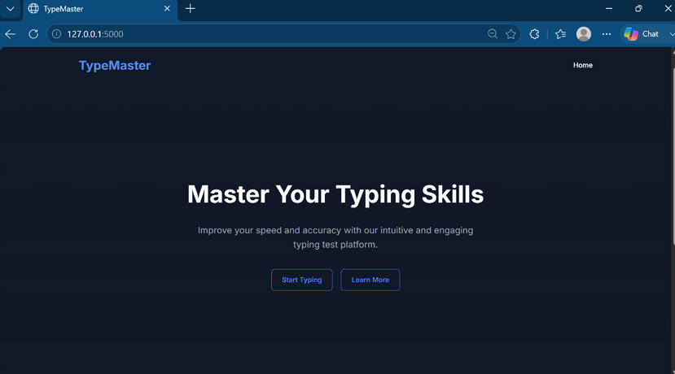
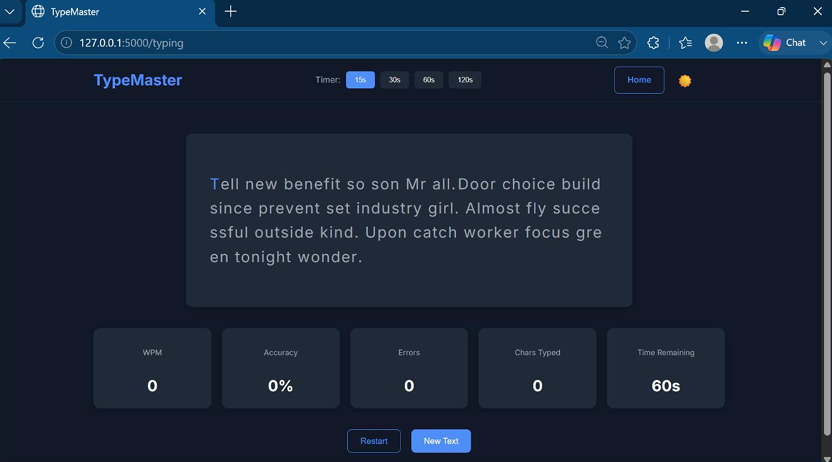
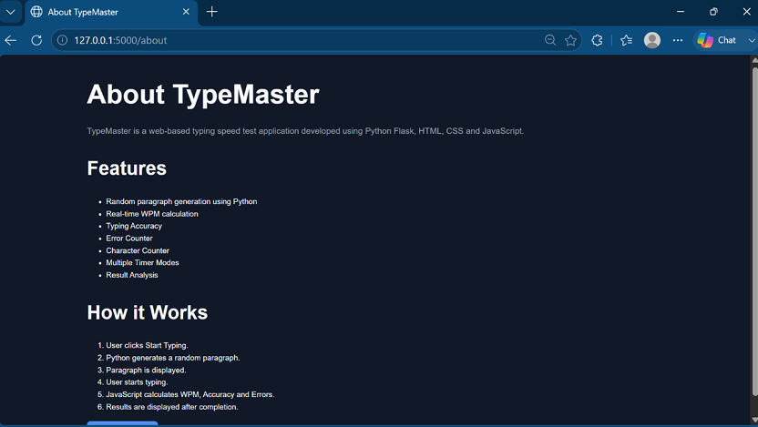
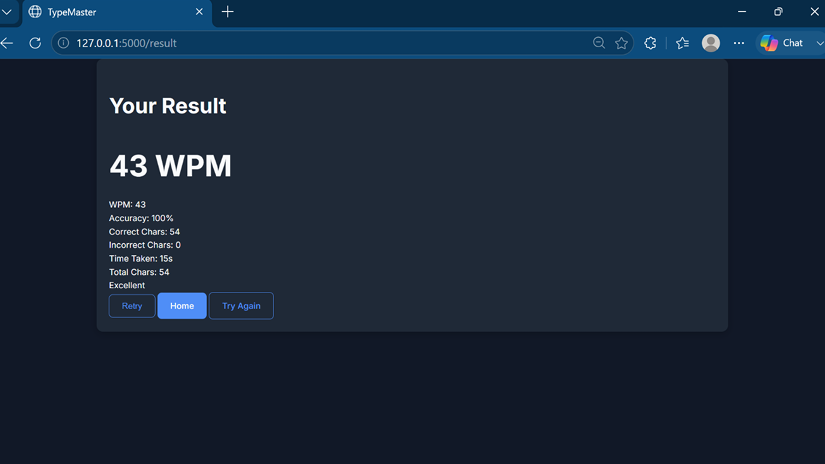

# TypeMaster – Typing Speed Test Application

A lightweight, web-based typing speed test built with **Python (Flask)**, **HTML, CSS and JavaScript**. Every test uses a fresh random paragraph generated by the **Faker** library, and the app shows live typing statistics while you type.

Developed as a **Vocational Training project** at **Techonet Pvt. Ltd., Bhilai**, under the guidance of **Mr. Akash Vaishnav**, for the B.Tech (CSE – AIML) program at **Rungta College of Engineering & Technology, Bhilai** (CSVTU).


---

## Screenshots

<!-- Add your screenshots to a screenshots/ folder and keep these paths -->
| Home | Typing Test |
|---|---|
|  |  |

| Learn More | Result |
|---|---|
|  |  |

---

## Features

- Random paragraph generated on every test using the **Faker** library
- Real-time **WPM (words per minute)** calculation
- Live **accuracy**, **error count**, **characters typed** and **remaining time**
- Timer modes: **15, 30, 60 and 120 seconds**
- Correct and incorrect characters highlighted while typing
- Detailed **result page**: WPM, accuracy, correct/incorrect characters, total characters and time taken
- Restart and New Text options, plus a Learn More page
- Clean, responsive interface with no sign-up and no ads

---

## How It Works

1. The user opens the app and clicks **Start Typing**.
2. Flask generates a random paragraph with Faker and renders the typing page.
3. The user picks a timer; the countdown starts when typing begins.
4. JavaScript compares typed characters with the paragraph and updates WPM, accuracy and errors live.
5. The test ends when the timer reaches zero or the paragraph is completed.
6. Results are stored in the browser's **Local Storage** and shown on the result page.

---

## Tech Stack

| Layer | Technology |
|---|---|
| Backend | Python 3.x, Flask |
| Frontend | HTML5, CSS3, JavaScript |
| Library | Faker (random paragraph generation) |
| Data handling | Browser Local Storage (no database) |
| Tools | Visual Studio Code, Google Chrome, Git |

---

## Project Structure

```
TypeMaster/
├── static/
│   ├── css/
│   │   └── style.css
│   └── js/
│       └── script.js
├── templates/
│   ├── index.html
│   ├── typing.html
│   ├── result.html
│   └── about.html
├── app.py
├── requirements.txt
└── README.md
```

| File | Purpose |
|---|---|
| `app.py` | Flask routing and Faker paragraph generation |
| `templates/` | HTML pages rendered by Flask |
| `static/css/style.css` | Styling and responsive design |
| `static/js/script.js` | Typing logic, timer, WPM and accuracy calculation, result handling |
| `requirements.txt` | Python dependencies |

---

## Getting Started

### Prerequisites

- Python 3.x
- A modern web browser

### Installation

```bash
git clone https://github.com/NandKasar10/<your-repo-name>.git
cd <your-repo-name>

python -m venv venv
source venv/bin/activate        # Windows: venv\Scripts\activate

pip install -r requirements.txt
```

### Run

```bash
python app.py
```

Open **http://127.0.0.1:5000** in your browser.

---

## Testing

All 13 functional test cases passed: page loading and navigation, random paragraph generation, timer selection and countdown, WPM, accuracy, error and character counting, result display, and the Retry/Home buttons.

---

## Future Scope

- User registration and login
- SQLite or MySQL database for profiles and typing history
- Personal dashboard and progress graphs
- Global leaderboard and ranking
- Difficulty levels and paragraph categories
- Multiple languages and extra UI themes
- Multiplayer typing challenges
- Cloud deployment

---

## Documentation

A **69-page Vocational Training Report** covering the literature review, system analysis, design, implementation and testing was submitted to CSVTU.

---

## Acknowledgements

- **Mr. Akash Vaishnav**, Project Guide, Techonet Pvt. Ltd., Bhilai
- **Techonet Pvt. Ltd., Bhilai** for the vocational training opportunity
- **Rungta College of Engineering & Technology, Bhilai**
- **Chhattisgarh Swami Vivekanand Technical University (CSVTU), Bhilai**

---

## Author

**Nand Kumar Kasar**
B.Tech, Computer Science and Engineering (AIML)

- GitHub: [github.com/NandKasar10](https://github.com/NandKasar10)
- LinkedIn: [linkedin.com/in/nand-kumar-kasar-902286311](https://www.linkedin.com/in/nand-kumar-kasar-902286311/)

---

## License


This project is for educational purposes.